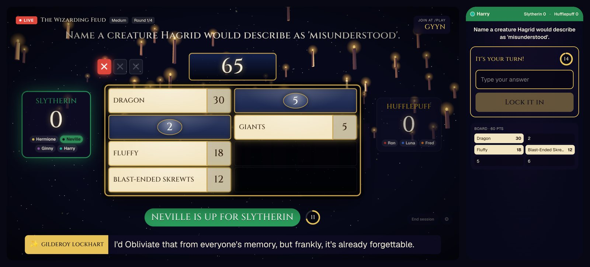
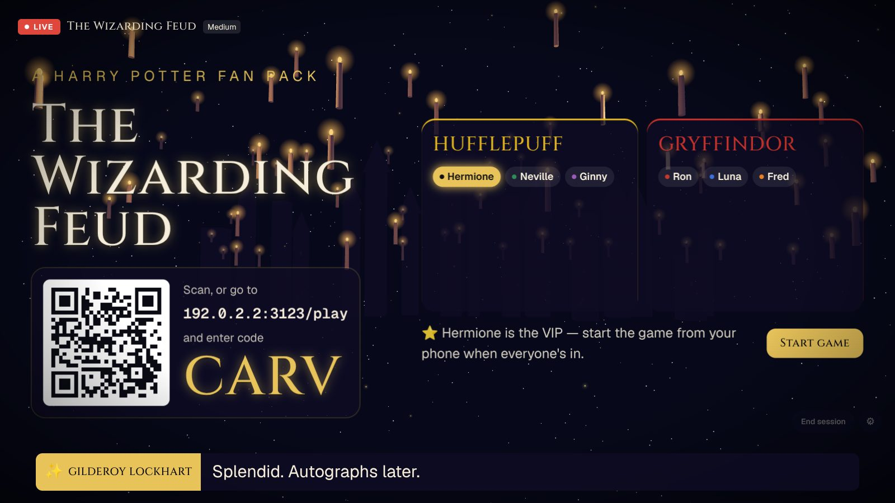
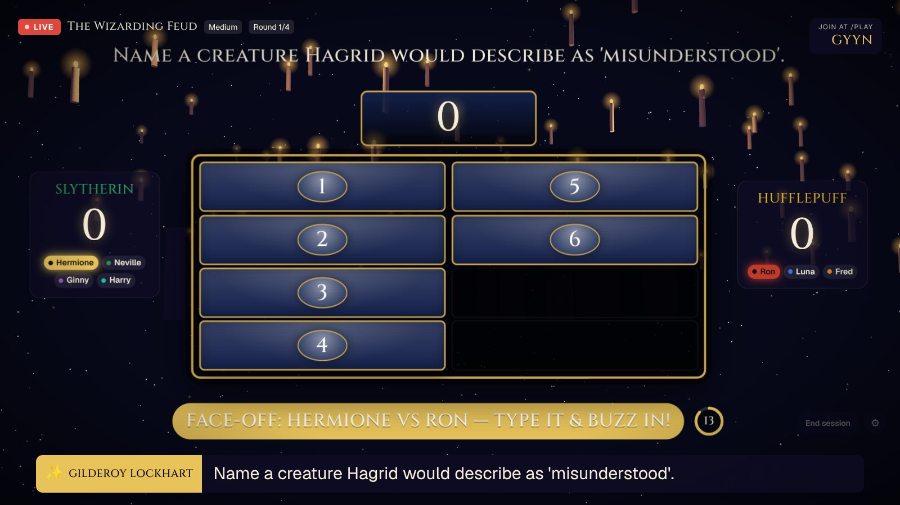
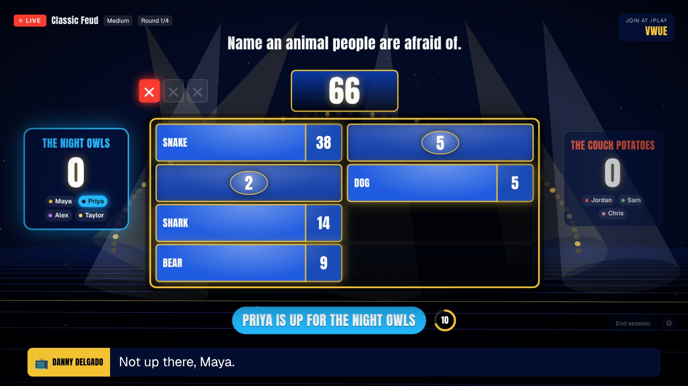

# Family Feud Live

**A live, multiplayer Family Feud party game with an AI host.** The show runs on a TV or laptop, and everyone plays from their phone: scan the QR code, pick a team, buzz in, type answers, and steal. Every screen stays in sync in real time.

It deploys for **free** in about two minutes, with **no AI costs**. When you want more, turn on the AI host: it writes a new survey for every game (on any topic you type), judges answers like a real Feud judge, and talks back in character with its own voice.



**[Live demo](https://family-feud-self.vercel.app)** · **[Deploy free](#deploy-your-own-free)** · **[Level up with AI](#level-up-turn-on-the-ai-host)** · **[Make your own pack](docs/creating-a-pack.md)** · **[Security](SECURITY.md)**

> Fan-made party game. Not affiliated with or endorsed by Family Feud / Fremantle, J.K. Rowling, Warner Bros. or Wizarding World. The packs contain no official art, music or logos. All visuals and music are generated in code.

---

## What it is

Family Feud Live is played the Jackbox way: one shared screen, and a phone for every player. No app to install and no accounts to make.

It ships with three packs:

- **The Wizarding Feud**, a Harry Potter fan pack hosted by Gilderoy Lockhart, with floating candles, an enchanted ceiling and a castle skyline.
- **Classic Feud**, with studio lights, a big blue board and a punchy game-show host.
- **Any Topic**, where the AI writes a survey about whatever you type ("The Office", "90s cartoons", "our company offsite").

| The lobby: scan to join | The face-off | The Classic pack |
| --- | --- | --- |
|  |  |  |

## How a game plays

1. **Open the site on the big screen** and pick a pack, the number of rounds (3-5) and a difficulty. Click **Create game**, then **Go on air**.
2. **Everyone scans the QR code** (or goes to `/play` and types the 4-letter room code), enters a name and lands on a team. Up to 16 players.
3. **The VIP starts the game** from their phone. The host explains the rules.
4. **Face-off.** The question appears for the first time. One player from each team types an answer and buzzes in. The top answer wins outright; otherwise the higher answer wins, and that team chooses to **play or pass**.
5. **The board.** Teammates take turns guessing, 15 seconds each. Three strikes and the other team gets one chance to **steal** the points.
6. **Late rounds are worth double and triple.** The team with the most points at the end wins, and the host signs off with a recap.

Difficulty sets both the questions and the judging:

- **Easy:** famous, everyday questions, and generous judging (a description like "candy shop" counts for Honeydukes).
- **Medium:** trickier questions. The answer itself, another name for exactly that thing, or a misspelling.
- **Hard:** deep cuts, and strict judging: the answer or one of its listed names, give or take a typo.

---

## Deploy your own (free)

One click, no credit card, and nothing to configure by hand:

[](https://vercel.com/new/clone?repository-url=https%3A%2F%2Fgithub.com%2Fgocougs2020%2Ffamily-feud&project-name=family-feud&repository-name=family-feud&stores=%5B%7B%22type%22%3A%22integration%22%2C%22integrationSlug%22%3A%22supabase%22%2C%22productSlug%22%3A%22supabase%22%2C%22protocol%22%3A%22storage%22%7D%5D&env=AI_DISABLED&envDefaults=%7B%22AI_DISABLED%22%3A%221%22%7D&envDescription=Keep%20AI_DISABLED%3D1%20for%20a%20%240%20deployment%3A%20built-in%20questions%2C%20browser%20voice%2C%20no%20AI%20usage.%20Set%20it%20to%200%20later%20to%20turn%20on%20the%20AI%20host.&envLink=https%3A%2F%2Fgithub.com%2Fgocougs2020%2Ffamily-feud%23level-up-turn-on-the-ai-host)

1. **Sign in to Vercel** (the free Hobby plan is enough). Vercel copies this repo to your GitHub account.
2. **Add Supabase** when asked, and choose the **Free** plan. That creates the database and sets every Supabase variable for you.
3. **Leave `AI_DISABLED` set to `1`.** That's the free switch: the game never calls an AI model, so there's nothing to pay for.
4. **Click Deploy.** The build creates the database tables on its own (`scripts/migrate.mjs`), so there's no SQL to paste.

Open your new site on a TV or laptop and create a game. The footer of the home page shows "Sync: Supabase Realtime" when everything is connected.

### What it costs

| Service | Plan | Cost |
| --- | --- | --- |
| Vercel (hosting) | Hobby | $0 |
| Supabase (database + real-time) | Free | $0 |
| AI | Off (`AI_DISABLED=1`) | $0 |

### What you get on the free setup

The whole game: the 3D stage, the flipping board, music and sound effects, real Feud rules, every difficulty, and real-time sync for up to 16 players a room. The host reads hand-written lines in your browser's built-in voice, and the questions come from each pack's built-in surveys. **Any Topic** falls back to classic questions until you turn AI on.

One thing to know: free Supabase projects **pause after a week without use**. Un-pause yours from the Supabase dashboard before game night.

<details>
<summary>Already have a Supabase project, or deploying by hand?</summary>

Set these on your Vercel project (Production and Preview), then redeploy:

| Variable | Where to find it (Supabase dashboard) |
| --- | --- |
| `NEXT_PUBLIC_SUPABASE_URL` | Project Settings → API → Project URL |
| `NEXT_PUBLIC_SUPABASE_PUBLISHABLE_KEY` | Project Settings → API Keys → publishable (or legacy `anon`) key |
| `SUPABASE_SECRET_KEY` | Project Settings → API Keys → secret (or legacy `service_role`) key. Copy it from the dashboard: the Supabase CLI shows new-style secret keys masked. |
| `POSTGRES_URL_NON_POOLING` | Connect → Session pooler connection string (used only to run migrations at build time) |
| `SESSION_SECRET` *(optional)* | Any long random string, e.g. `openssl rand -base64 32`. It defaults to the Supabase secret key. |
| `AI_DISABLED` | `1` for a free, AI-free deployment. Leave it unset to turn the AI host on. |

Without `POSTGRES_URL_NON_POOLING`, run the files in [`supabase/migrations`](supabase/migrations) in order in the SQL editor instead, or run `pnpm db:migrate` from your machine.

Without a database, a deployment falls back to in-memory games. That only works inside one server process, so the home page shows a warning until Supabase is connected.
</details>

<details>
<summary>Why Supabase?</summary>

The game needs a database **and** real-time push to every phone. Supabase's free plan has both: Postgres, plus Realtime with up to 200 concurrent connections. It's also on the Vercel Marketplace, so the Deploy button can set it up for you. Free Postgres hosts like Neon or Turso would need a second service for real-time (Pusher, Ably, Liveblocks), or every phone polling the server.
</details>

## Run it locally

No accounts or keys needed:

```bash
pnpm install
pnpm dev
```

Open http://localhost:3000 and click **Create game**. With no environment variables, games are kept in memory and use the built-in questions. Everything works, including real-time sync (over Server-Sent Events).

To play with real phones on your Wi-Fi, run a production build on your network and open the TV screen at your computer's address, so the QR code points somewhere phones can reach. (Use `pnpm start`, not `pnpm dev`: the dev server only serves its scripts to `localhost`.)

```bash
pnpm build && pnpm start -H 0.0.0.0
# then open http://<your-computer's-LAN-IP>:3000 on the TV
```

---

## Level up: turn on the AI host

Start free, then turn things on as you go. Each step is an environment variable, so you can move up or back down at any time.

| Level | What to set | What you get | AI cost |
| --- | --- | --- | --- |
| **1. Free** | `AI_DISABLED=1` | Built-in surveys, hand-written host lines, the browser's voice | $0 |
| **2. AI writer** | Remove `AI_DISABLED` and set `AI_VOICE_DISABLED=1` | A new survey every game, **Any Topic**, AI answer judging, and host lines written live for each moment of the game. The browser still does the voice. | Low |
| **3. Full show** | Remove `AI_DISABLED` | Everything above, plus a real performed voice for the host (Fish Audio `drama-3`), a sentence at a time with synced captions | Higher (text-to-speech is most of the cost) |
| **4. Make it yours** | Model, voice and pack settings below | Pick the models, cast a voice for each pack, build your own packs | You choose |

### Turning it on

**On Vercel:** open your project → **Settings → Environment Variables**, delete `AI_DISABLED` (or set it to `0`), then **Deployments → ⋯ → Redeploy**. Vercel deployments sign in to the [AI Gateway](https://vercel.com/docs/ai-gateway) on their own with a short-lived OIDC token, so there's **no API key to create, paste or leak**. Usage is paid from your Vercel team's AI Gateway credits.

**Locally:** [create an AI Gateway key](https://vercel.com/d?to=/[team]/~/ai/api-keys) in your Vercel dashboard and put it in `.env.local`, which git ignores:

```bash
cp .env.example .env.local
# then set AI_GATEWAY_API_KEY=... in .env.local
```

The home page footer shows "AI host: on" when it's working.

### What the AI host does

- **Writes a new survey every game** at the game's difficulty, while players are still joining: questions, ranked answers with points, strict aliases ("Ron" for "Ron Weasley") and looser phrasings for easy mode.
- **Judges fuzzy answers** like a real Feud judge, as strictly as the difficulty says. A fast local matcher handles exact answers, plurals and typos first, and only the guesses it can't decide go to a small decision model.
- **Writes every host line in character**: greeting players by name as they join, calling up each face-off, reacting to each answer and saying what's at stake, and signing off with a recap. Reactions to every answer on the board are written a round ahead, so a found answer gets a sharper line that's already voiced.
- **Voices the host** a sentence at a time: the first sentence plays while the rest are made, and repeated lines ("Survey says…") are voiced once.
- **Never stalls the game.** If the AI is off, slow (a live line gets about 5 seconds) or out of credits, the game falls back to the built-in surveys, canned lines and the browser's voice.

### Keeping AI costs in check

- **Credits are prepaid.** The AI Gateway spends credits you've bought, so a busy night can't send you a surprise bill. If credits run out, the game keeps working on its free fallbacks. Leave auto top-up off for a firm cap.
- **Set a budget** in the AI Gateway section of the Vercel dashboard, or with `vercel ai-gateway budgets set team --limit 10 --refresh-period monthly`.
- **Drop the voice** with `AI_VOICE_DISABLED=1`. Text-to-speech is billed per sentence and is most of what a game spends.
- **Use cheaper models** for the big jobs, e.g. `AI_MODEL=anthropic/claude-haiku-5.5` for survey writing.
- **Rate-limit game creation** if your URL is public. [SECURITY.md](SECURITY.md#protect-your-ai-budget-if-you-turn-ai-on) has a ready-made Vercel Firewall rule.

Where the usage goes, per game: one survey-writing call on `AI_MODEL`; one call per round on `AI_MODEL` to write that round's reactions ahead; one short `AI_FAST_MODEL` call per live host line; one `AI_JUDGE_MODEL` call per guess the local matcher can't decide; and, at level 3, one `AI_TTS_MODEL` call per spoken sentence (a round's likely reactions are voiced ahead, which adds a few hundred characters of speech per round).

---

## Customize it

### Models

Any `provider/model` the [AI Gateway](https://vercel.com/ai-gateway/models) supports works. Each job has its own setting:

| Variable | Default | Job |
| --- | --- | --- |
| `AI_MODEL` | `openai/gpt-6.1-sol` (medium reasoning) | Writes the survey and each round's reactions ahead. One big, quality-sensitive call per game, made while players join. |
| `AI_FAST_MODEL` | `anthropic/claude-haiku-5.5` (reasoning off) | Writes live host lines. Short and many, so it has to be quick. |
| `AI_JUDGE_MODEL` | `typesafe-ai/jev` | A decision model that picks which board answer a guess matches. Quick and cheap: it chooses from a list instead of writing text. |
| `AI_TTS_MODEL` | `fish-audio/drama-3` | The host's voice. |

### The host's voice

- **Cast a voice per pack** with `AI_TTS_VOICE_<PACK_ID>`, e.g. `AI_TTS_VOICE_HARRY_POTTER=<id>` (a Fish Audio voice id is the last part of a `fish.audio/m/<id>` link). `AI_TTS_VOICE` sets one voice for every pack.
- **Delivery is written into the text.** Fish Audio takes no separate instructions, so each pack's delivery goes in as inline cues (`[smug, theatrical British showman]`, plus any `[scoffs]` the host writes), which are stripped from the on-screen captions.
- **Pacing.** The host talks a little faster than the model's natural pace. If the voice model ignores the speed setting, the TV speeds the clip up instead. Set `AI_TTS_NATIVE_SPEED=0` to always do it in the browser.

### Your own pack

A pack is two files: a **theme** (name, colors, fonts, 3D scene, music mood, host name and voice, team names) that's safe to send to browsers, and a server-only **content** file (host persona, AI guidance, topic angles, fallback surveys and canned lines). Write a few fallback surveys and your pack works on the free setup too. See **[docs/creating-a-pack.md](docs/creating-a-pack.md)**.

Ideas: your family's inside jokes, a company offsite pack, a pack for your favorite show, a holiday pack.

---

## Security

The project is built to be safe to fork and host publicly. The short version:

- **No secrets in the repo**, in the code or its history. `.env*` files are git-ignored, and `.env.example` only lists variable names.
- **No AI key on Vercel.** Deployments use short-lived OIDC tokens. A local key lives only in `.env.local`.
- **Only public values reach the browser:** the Supabase URL and publishable key, which can read nothing but public game state.
- **Hidden answers stay on the server**, in tables with Row Level Security on and no policies, until they're revealed on the board.
- **Signed seats.** The TV and each phone get an HMAC-signed token tied to one game and one role, so a phone can't act as the TV or as another player. All rules run on the server.
- **Can't be abused as a free text-to-speech API.** The voice route only speaks the host line on screen right now, and only for that game's TV.
- **Rooms expire** within an hour and clean themselves up.

Details, the cost guardrails for public deployments, and how to report a vulnerability are in **[SECURITY.md](SECURITY.md)**.

---

## How it works

```
 Phones (/play/ABCD)          TV (/host/ABCD)
   │ POST /action               │ POST /action {tick} when a timer ends
   ▼                            ▼
 Route handlers ──► game-service ──► engine (pure rules) ──► store.mutate (compare-and-swap on version)
                       │                                         │
                       └─ AI Gateway: write survey / judge / recap │
                                                                   ▼
                                     Supabase `games` row ──Realtime──► every screen
                                     (memory + SSE in local dev)
```

- **One row per game.** `games.state` is the public state (players, board, scores, turn, host line). Every screen subscribes to that row with Supabase Realtime `postgres_changes`, and also re-fetches on focus and every few seconds, so a dropped socket never leaves a phone stuck.
- **Hidden answers never reach the browser.** The survey lives in `game_secrets`, and the host's lines written ahead (which name the answers) in `game_line_banks`, one row per round. Only the server's secret key can read them. A tile's answer is copied into public state only when it's revealed.
- **Race-free buzzing.** Every write is `read → apply pure rule → update … where version = n`, retried on conflict, so two buzzes in the same millisecond resolve cleanly.
- **No server timers.** Each phase stores a `deadline`. The TV asks the server to `tick` when it passes, and phones do the same a little later as a backup. The server checks the deadline itself, so these calls are idempotent.
- **Turns wait for the host.** A turn that starts with a new host line is held until that line is spoken: the TV sends `line_done` when its voice finishes, and a speech-length estimate opens it anyway if the TV doesn't. Each round's question stays hidden until the face-off opens, so nobody gets a head start.
- **Rooms clean themselves up.** A room shuts when the host ends it, when the TV window closes and doesn't come back within 20 seconds, or an hour after it was created. Rows are deleted by `delete_stale_games`, run every five minutes by `pg_cron` where available and whenever a game is created.
- **No accounts.** Joining returns an HMAC-signed seat token, kept in `localStorage` and sent as a Bearer header.
- **Everything audible is generated.** The music (a candle-lit waltz, a studio groove) is composed in code from a random seed each game, and the sound effects are synthesized. There are no audio files.

### Tech stack

[Next.js 16](https://nextjs.org) (App Router) · React 19 · TypeScript · Tailwind CSS 4 · [React Three Fiber](https://r3f.docs.pmnd.rs) / three.js · Motion · [Vercel AI SDK](https://ai-sdk.dev) + [AI Gateway](https://vercel.com/ai-gateway) · [Supabase](https://supabase.com) (Postgres, Realtime, Row Level Security) · Zod · Vitest

### Project layout

```
src/
  app/                    routes: / (home), /host/[code] (TV), /play/[code] (phone), /api/games/...
  components/host/        TV stage, board, 3D scene, CSS fallback backdrop
  components/play/        phone controller
  lib/engine.ts           all game rules as pure functions (unit-tested)
  lib/game-service.ts     orchestrates store + engine + AI
  lib/ai.ts               survey writer, answer judge, host lines, recap, host voice (AI SDK + Gateway)
  lib/match.ts            fast local answer matching (aliases, plurals, typos), by difficulty
  lib/difficulty.ts       what each difficulty accepts
  lib/auth.ts             signed seat tokens
  lib/store/              memory (dev) and Supabase stores
  lib/client/             realtime hook, API client, synthesized audio, speech
  packs/                  question packs: theme (client) + content (server)
supabase/migrations/      database schema
```

### Scripts

| Command | What it does |
| --- | --- |
| `pnpm dev` | Start the dev server |
| `pnpm test` | Run the engine, matcher, captions and AI unit tests (Vitest) |
| `pnpm typecheck` | TypeScript check |
| `pnpm lint` | ESLint |
| `pnpm build` | Apply database migrations (if a database URL is set), then a production build |
| `pnpm db:migrate` | Apply `supabase/migrations/*.sql` to the database in `POSTGRES_URL_NON_POOLING` / `DATABASE_URL` |

## Ideas and contributions welcome

- Fast Money bonus round
- Host-side answer override ("the judges will allow it")
- AI-generated scene art per pack
- More packs: send a PR!

## License

[MIT](LICENSE). Pack content is fan-made and provided for non-commercial fun.
